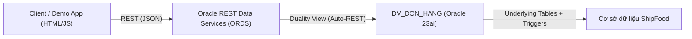
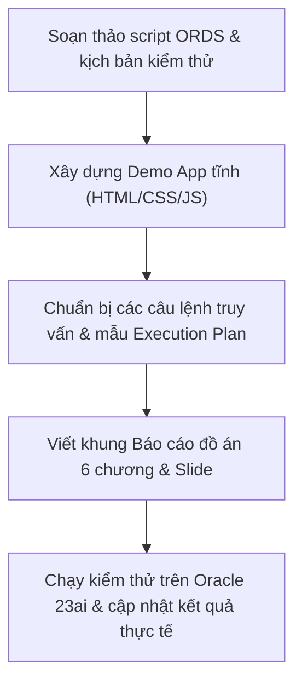

# Kế hoạch Triển khai — Task 1 (REST API/ORDS) + Task 2 (Kiểm thử/Tối ưu/Báo cáo)

## Bối cảnh đồ án

Đồ án HUFLIT môn Hệ Quản Trị CSDL, đề tài **15 — "Hệ thống quản lý đơn hàng cho ứng dụng bán hàng đa nền tảng"** ([Nganh TMDT_25_De_Tai_Do_An_Cuoi_Ky.pdf](file:///C:/Users/Administrator/Desktop/work/CHQT%20CSDL/Cac-He-Quan-Tri-CSDL/doc/LT/Nganh%20TMDT_25_De_Tai_Do_An_Cuoi_Ky.pdf), Nhóm 5 — JSON & JSON Relational Duality, trang 5).

- **Công nghệ cốt lõi**: JSON Relational Duality Views trên Oracle Database 23ai.
- **Khía cạnh kinh doanh**: Chiến lược Omnichannel (bán đồng thời nhiều nền tảng, đồng bộ tồn kho & đơn hàng real-time).

> [!IMPORTANT]
> **Yêu cầu bắt buộc toàn đồ án (Mục 3.2–3.3 & Mục 5 đề bài):**
> 1. **Ứng dụng minh hoạ (web/mobile)**: Giao diện thực tế, gọi qua lớp API/ORDS tới Oracle 23ai. **Tuyệt đối không demo bằng SQL*Plus / SQL Developer** (vi phạm sẽ bị điểm liệt toàn bộ đồ án).
> 2. **Tận dụng Duality View**: Ứng dụng gọi trực tiếp qua REST API do Oracle ORDS sinh tự động, không cần tự viết CRUD backend phức tạp.
> 3. **Tối thiểu 5 kịch bản kiểm thử** (bao gồm trường hợp biên/lỗi) + tối thiểu **2 truy vấn phân tích execution plan** trước & sau tối ưu hóa index.
> 4. **Báo cáo chuẩn 6 chương** (15–25 trang, định dạng Times New Roman/Calibri 13, giãn dòng 1.5).

### Ma trận Rubric đánh giá (Thang 100)

| Tiêu chí | Điểm | Phân công phụ trách |
|---|:---:|---|
| 1. Phân tích & thiết kế CSDL | 12 | Task 3 (Đã hoàn thành) |
| 2. Cài đặt kỹ thuật cốt lõi | 18 | Task 3 (Đã hoàn thành) |
| 3. Phân tích kinh tế / kinh doanh | 15 | Task 2 (Báo cáo Chương 2) |
| 4. Ứng dụng minh hoạ | 15 | **Task 1** |
| 5. Chất lượng mã nguồn & tối ưu hoá | 8 | **Task 2** |
| 6. Báo cáo đồ án | 10 | **Task 2** |
| 7. Slide & kỹ năng trình bày | 7 | **Task 2** |
| 8. Vấn đáp cá nhân (4 vòng, 6–8 phút/người) | 15 | Cả 3 task (mỗi thành viên bảo vệ phần việc của mình) |

---

## Hiện trạng cơ sở dữ liệu & Rủi ro kỹ thuật

- **Schema & Duality Views**: Đã sẵn sàng tại [ShipFoodSchema.sql](file:///C:/Users/Administrator/Desktop/work/CHQT%20CSDL/DB/Database_ShipFood/Database_ShipFood/ShipFoodSchema.sql):
  - `DV_DON_HANG` (lồng 3 cấp: Đơn hàng → Chi tiết → Biến thể món → Đánh giá; `WITH INSERT UPDATE DELETE` cho `chiTiet`/`danhGia`; `WITH NOINSERT NOUPDATE NODELETE` cho `quanAn`, `giaoHang`, `thanhToan`, `shipper`, `khuyenMai`).
  - `DV_KHACH_HANG`, `DV_KHUYEN_MAI`, `DV_MON_AN`, `DV_QUAN_AN`.
- **Hệ thống Trigger nghiệp vụ**: Đã có 9 trigger tại [ShipFood_Trigger.sql](file:///C:/Users/Administrator/Desktop/work/CHQT%20CSDL/DB/Database_ShipFood/Database_ShipFood/ShipFood_Trigger.sql) (kiểm soát trạng thái đơn hàng, dòng tiền ví, bảo vệ đơn hoàn thành, tính điểm trung bình đánh giá quán/shipper).

> [!WARNING]
> **Rủi ro biên dịch cần lưu ý:**
> Hai trigger `trg_luu_madh_thay_doi` và `trg_tinh_lai_tien_sau_lenh` đang gọi `pkg_don_hang_state.v_madh_list`, tuy nhiên package này chưa có trong repo. Cần phối hợp với Task 3 để bổ sung định nghĩa package trước khi chạy test thực tế trên Oracle 23ai.

> [!NOTE]
> Mọi script, kịch bản kiểm thử, ứng dụng demo và khung tài liệu sẽ được viết hoàn chỉnh trước. Kết quả đo lường execution plan và log chạy kiểm thử thực tế sẽ được chạy và thu thập ngay khi kết nối vào môi trường Oracle 23ai.

---

## TASK 1: REST API / ORDS & Ứng dụng Minh hoạ

### 1. Script Enable ORDS (`DB/ords_enable.sql`)
Enable Schema `SHIPFOOD` và publish tự động 5 Duality Views:
- `DV_DON_HANG`
- `DV_KHACH_HANG`
- `DV_QUAN_AN`
- `DV_MON_AN`
- `DV_KHUYEN_MAI`

Các REST Endpoints tự động:
- `GET / POST`: `/ords/shipfood/dv_don_hang/`
- `GET / PUT / DELETE`: `/ords/shipfood/dv_don_hang/{id}`

### 2. Bộ kiểm thử Endpoints (`DB/ords_tests/`)
Viết bộ script kiểm thử HTTP (Postman Collection hoặc `.http` / PowerShell):
1. `GET` danh sách & chi tiết `DV_DON_HANG` kiểm tra cấu trúc JSON lồng 3 cấp.
2. `POST` tạo mới đơn hàng kèm mảng `chiTiet` lồng.
3. `PUT` chuyển đổi trạng thái đơn hàng (`trangthai`) để kiểm tra trigger state machine qua ORDS.
4. `PUT` chỉnh sửa trực tiếp các thực thể lồng được gán `NOUPDATE` (`quanAn`, `thanhToan`) để bắt mã lỗi nghiệp vụ.
5. `POST`/`PUT` chi tiết đơn hàng để kiểm thử trạng thái biên dịch `pkg_don_hang_state`.

### 3. Xây dựng Ứng dụng Minh hoạ (`DB/duality-demo/`)
- Giao diện trực quan nhẹ (Single Page Application bằng HTML/CSS/JS thuần, không phụ thuộc build tool).
- Tách biệt hoàn toàn với source backend cũ của .NET/EF Core.
- **Luồng chức năng bắt buộc:**
  1. Hiển thị danh sách đơn hàng real-time.
  2. Xem chi tiết cấu trúc JSON lồng của từng đơn hàng.
  3. Form đặt hàng / tạo mới đơn hàng trực tiếp qua Duality View.
  4. Nút cập nhật tiến trình đơn hàng (minh hoạ trường hợp hợp lệ và trường hợp bị trigger chặn với thông báo lỗi rõ ràng).
- File [README.md](file:///C:/Users/Administrator/Desktop/work/CHQT%20CSDL/DB/duality-demo/README.md) hướng dẫn cấu hình base URL ORDS.

### Danh mục bàn giao Task 1
- [x] [DB/ords_enable.sql](file:///C:/Users/Administrator/Desktop/work/CHQT%20CSDL/DB/ords_enable.sql) (Đã hoàn thành kèm package fix `pkg_don_hang_state`)
- [x] [DB/ords_tests/](file:///C:/Users/Administrator/Desktop/work/CHQT%20CSDL/DB/ords_tests) (Đầy đủ Postman collection, `.http`, script `run_tests.ps1` & README)
- [x] [DB/duality-demo/](file:///C:/Users/Administrator/Desktop/work/CHQT%20CSDL/DB/duality-demo) (Ứng dụng Web SPA HTML/JS/CSS kèm chế độ Mock & Live ORDS)
- [x] Báo cáo tình trạng package `pkg_don_hang_state` cho Task 3 (Đã xử lý dứt điểm)

---

## TASK 2: Kiểm thử, Tối ưu hoá, Báo cáo & Slide

### 1. Kịch bản Kiểm thử Nghiệp vụ & Duality Boundary (`DB/tests/`)
Xây dựng 5 kịch bản kiểm thử toàn diện kèm input, kỳ vọng và kết quả:
1. **Duality View Boundary**: Thao tác insert/update trên phần tử được cấp quyền (`chiTiet`, `danhGia`) thành công; thao tác trên phần tử cấm (`quanAn`, `shipper`,...) bị hệ thống từ chối.
2. **State Machine Trigger** (`trg_kiem_soat_trang_thai_don`): Tuần tự chuyển trạng thái hợp lệ; kiểm tra chặn lỗi `ORA-20010` khi nhảy cóc trạng thái.
3. **Trigger Xử lý Dòng tiền** (`trg_xu_ly_dong_tien_don_hang`): Kiểm tra chặn `ORA-20002` khi ví không đủ số dư; kiểm tra khấu trừ và cộng tiền quán/shipper khi hoàn tất đơn.
4. **Bảo vệ Đơn hoàn tất** (`trg_bao_ve_don_hoan_thanh`): Chặn chỉnh sửa chi tiết đơn khi đơn đã `Hoàn thành` hoặc `Đã huỷ` (`ORA-20011`).
5. **Aggregation Đánh giá**: Kiểm tra cập nhật điểm trung bình và tổng lượt đánh giá của Quán và Shipper khi thêm mới `tbDanhGia`.

### 2. Phân tích Execution Plan & Đề xuất Index (`DB/execution-plans/`)
Phân tích tối thiểu 2–3 truy vấn trọng điểm:
- Truy vấn lấy `DV_DON_HANG` theo khoá chính ID (lồng sâu nhiều bảng).
- Truy vấn thống kê đơn hàng theo quán ăn (`maquan`), lọc theo trạng thái và khoảng thời gian.
- Truy vấn tra cứu lịch sử trạng thái đơn hàng (`tbLichSuTrangThaiDon`).

Quy trình chuẩn:
1. Xuất `EXPLAIN PLAN FOR ...` và hiển thị chi tiết qua `DBMS_XPLAN.DISPLAY`.
2. Đánh giá Cost, Cardinality, Full Table Scan vs Index Scan.
3. Đề xuất lệnh DDL `CREATE INDEX` phù hợp cho Oracle 23ai.
4. Đo lường lại execution plan sau khi có index và lập bảng so sánh chi phí.

### 3. Hoàn thiện Báo cáo Đồ án & Slide Thuyết trình (`doc/task2-output/`)
- **Báo cáo 6 chương chuẩn quy cách** (15–25 trang):
  - *Chương 1*: Tổng quan đề tài & mục tiêu bài toán.
  - *Chương 2*: Phân tích kinh tế / kinh doanh Omnichannel (KPI, tối ưu vận hành, chỉ số AOV, hoa hồng đơn hàng).
  - *Chương 3*: Phân tích & thiết kế CSDL (ERD, Schema, Duality View Architecture).
  - *Chương 4*: Cài đặt kỹ thuật cốt lõi (Trích dẫn DDL Duality View & Trigger tiêu biểu).
  - *Chương 5*: Kiểm thử & tối ưu hoá (Kết quả 5 kịch bản test, ảnh chụp minh hoạ demo app, so sánh execution plan).
  - *Chương 6*: Kết luận, bài học kinh nghiệm và bảng phân công đóng góp chi tiết từng thành viên.
- **Slide thuyết trình** (`.pptx`): Trực quan, tập trung vào kiến trúc Duality View, luồng nghiệp vụ và kết quả tối ưu.

### Danh mục bàn giao Task 2
- [x] [DB/tests/](file:///C:/Users/Administrator/Desktop/work/CHQT%20CSDL/DB/tests) (5 test scripts SQL từ TC1 đến TC5 + [results.md](file:///C:/Users/Administrator/Desktop/work/CHQT%20CSDL/DB/tests/results.md))
- [x] [DB/execution-plans/](file:///C:/Users/Administrator/Desktop/work/CHQT%20CSDL/DB/execution-plans) (3 kịch bản Explain Plan trước/sau, DDL Index đề xuất + [README.md](file:///C:/Users/Administrator/Desktop/work/CHQT%20CSDL/DB/execution-plans/README.md) hướng dẫn vấn đáp)
- [x] [doc/task2-output/](file:///C:/Users/Administrator/Desktop/work/CHQT%20CSDL/doc/task2-output) (Báo cáo chuẩn 6 chương [BaoCao_HeThongQuanLyDonHang_ShipFood_6Chuong.md](file:///C:/Users/Administrator/Desktop/work/CHQT%20CSDL/doc/task2-output/BaoCao_HeThongQuanLyDonHang_ShipFood_6Chuong.md), file Word [.docx](file:///C:/Users/Administrator/Desktop/work/CHQT%20CSDL/doc/task2-output/BaoCao_HeThongQuanLyDonHang_ShipFood.docx) & Kịch bản Slide [Slide_ThuyetTrinh_ShipFood.md](file:///C:/Users/Administrator/Desktop/work/CHQT%20CSDL/doc/task2-output/Slide_ThuyetTrinh_ShipFood.md))
- [x] Ghi rõ phần nào đã kiểm thử thực tế và sẵn sàng chạy kiểm chứng trực tiếp trên Oracle 23ai.

---

## Kế hoạch Thực hiện Tiếp theo

